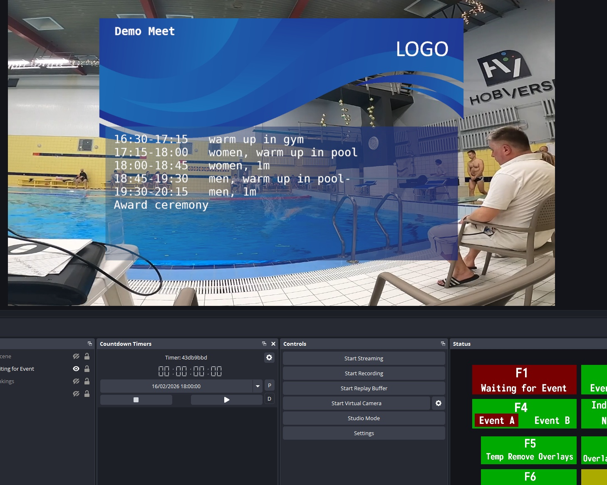
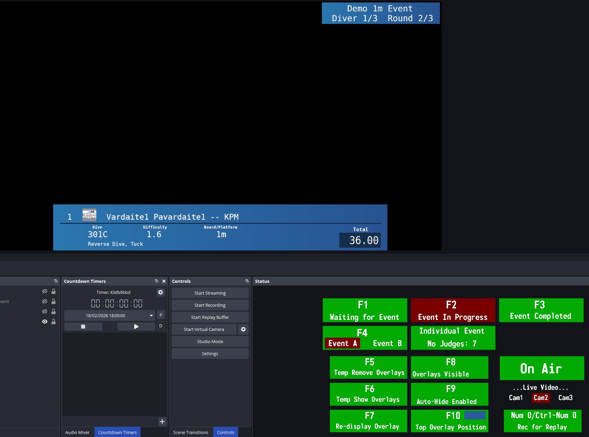
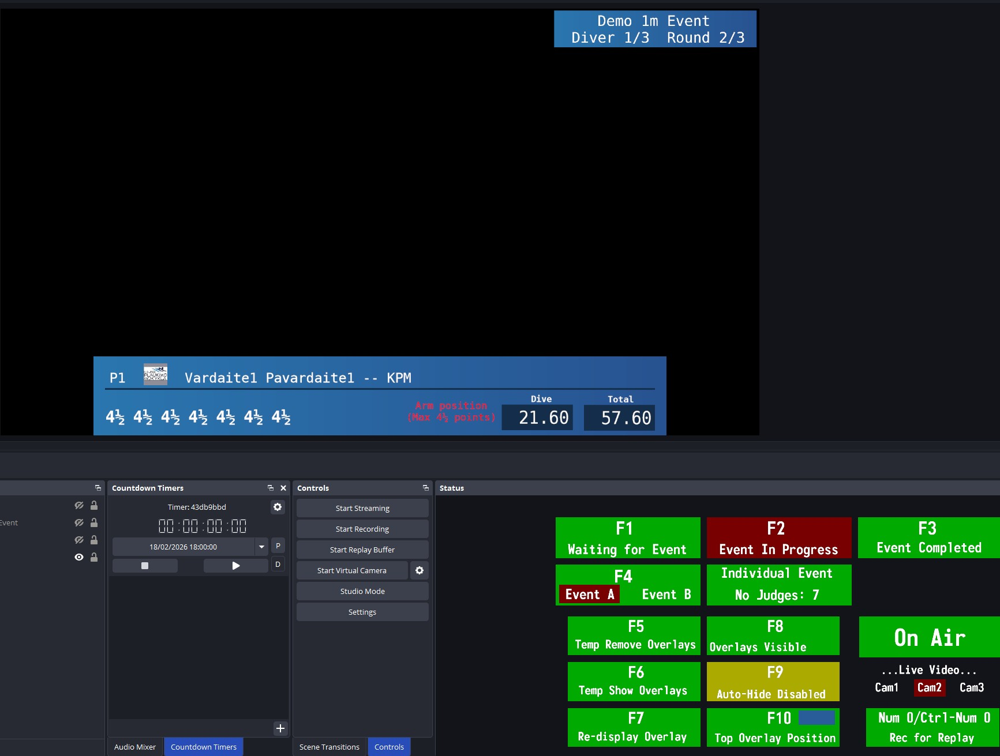
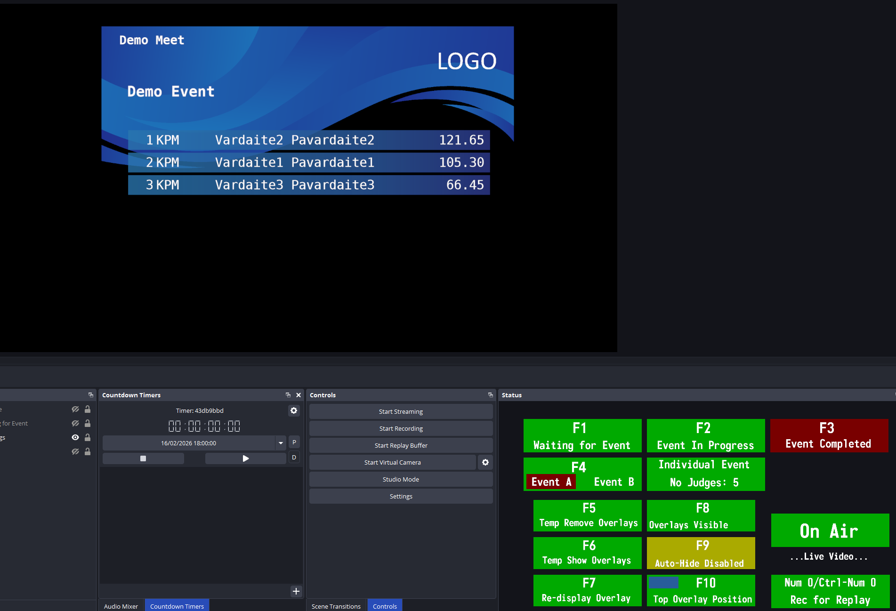
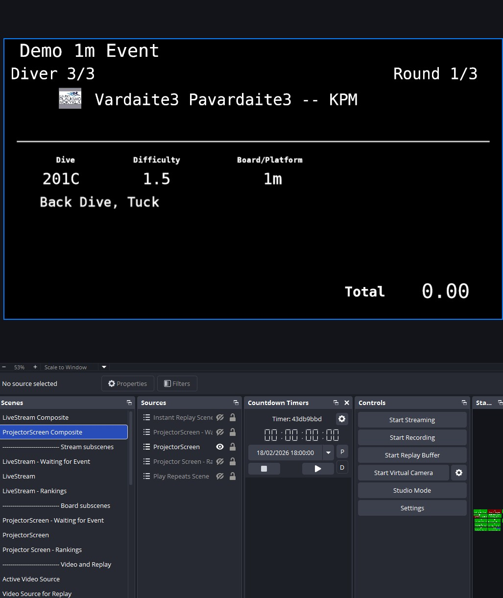
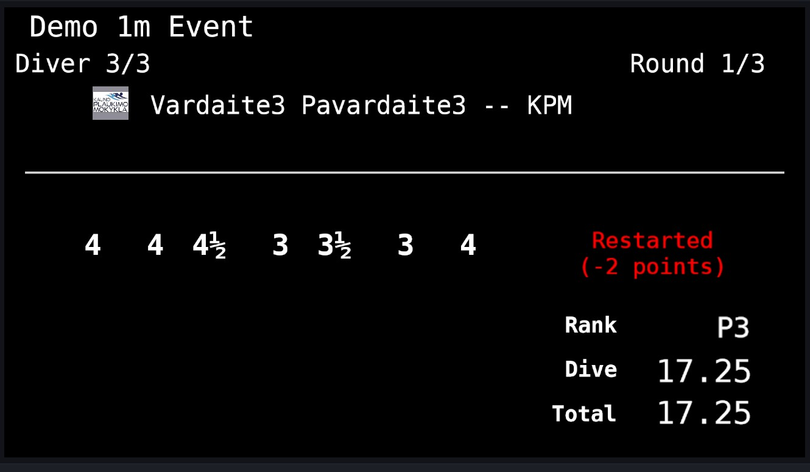
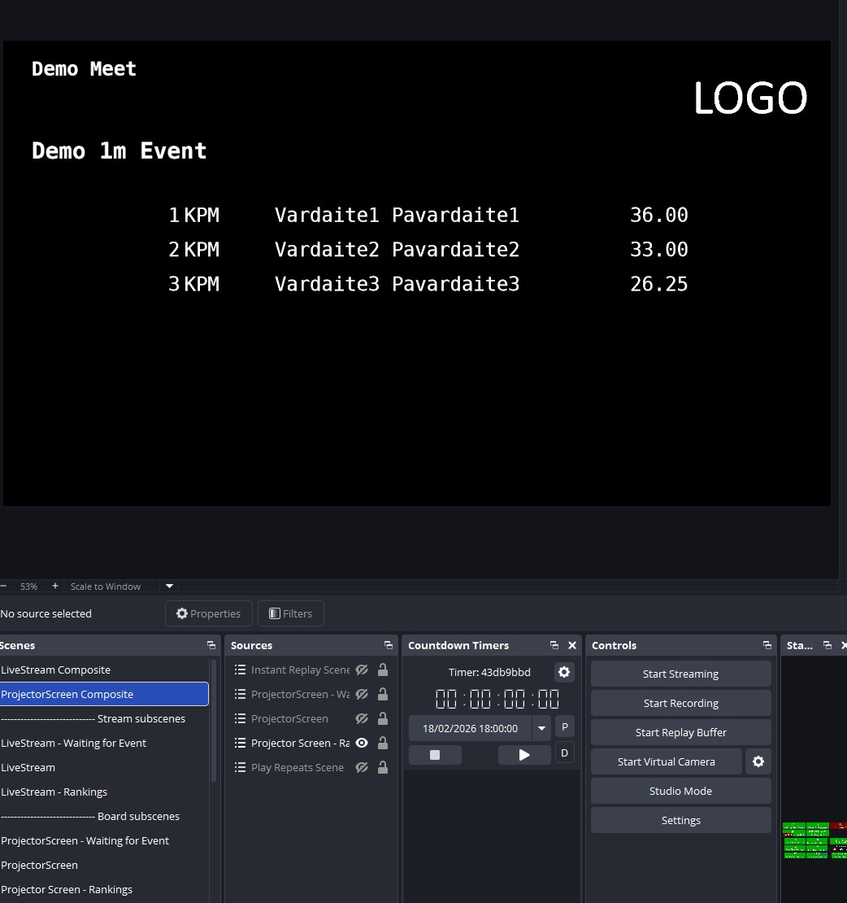

# Diving Overlays And Scoreboard

[OBS studio](https://obsproject.com/) Python script/scenes to present springboard/platform diving competition information in overlays for live streaming and on scoreboard in venue.\
Python port and heavy refactoring from @andy5211d [Andy's DR2TVOverlay](https://github.com/andy5211d/DR2TVOverlay)\
Supported diving software: [DiveRecorder 7.0.7.6](https://diverecorder.co.uk) and [DiveCalc 4.6.1](http://divecalc.net) (individual, team and synchro events).

## Updates

### Version 1.2.0: What's new?

- [DiveCalc](http://divecalc.net) integration
- Switched to variable-width fonts
- Added VisualPresets utility to provide easy way to switch between visual presets
- Added Competition Pacing utility for DiveCalc (not really related to Overlays)

## OBS version

At least 32.1.2 required

## Functionality

- Supported event types:
    - Individual
    - Synchro
    - Team (DiveCalc; DiveRecorder - when its bugs are resolved)

- Event modes:
    - Waiting for event displays
        - Countdown to next event
        - Event schedule
        - Start list
    - Event in progress
        - Next Diver/Dive information
        - Dive scores/penalties/totals
        - Instant dive replay
    - Event results
        - Rankings
        - Reveal/Show All modes (managed from DiveRecorder, Medal mode NOT supported)

- Streaming:
    - Multiple camera support. Camera switches performed by hotkeys, not scene switching in OBS
    - Instant Replay (slow motion possible)
        - Various alternative transitions to instant replays/easy switch between them
    - Instant Replay source can be set to specific camera in multiple camera setup or to currently active camera.

- Video Scoreboard
    - Special scenes without live camera feed for display on venue scoreboard. Plays dive replays.

- Simultaneous events ()
    - Can switch between A and B *DiveRecorder* events. Data in overlays will be from current event.
    - Anly A event for *DiveCalc*

- Status/Common hotkeys board

- Language - English only (dive position/penalty text hardcoded; DiveCalc descriptions are editable in csv file)

## Installation

### Fonts
Install two fonts (included in the bundle): **'DejaVu Sans Condensed' and 'Monofonto Regular'**.

### Required OBS Plugins:

- [Gradient Source](https://obsproject.com/forum/resources/gradient-source.1172/) (for graphics elements)
- [Move Transition](https://obsproject.com/forum/resources/move.913/) (for some source media automation)
- [Source Dock](https://obsproject.com/forum/resources/source-dock.1317/) (for status board)
- [advanced-scene-switcher](https://obsproject.com/forum/resources/advanced-scene-switcher.395/) (for scene scripting)
- [dir-watch-media](https://obsproject.com/forum/resources/directory-watch-media.801/) (for instant replay support)
- [osi-branch-output](https://obsproject.com/forum/resources/branch-output-streaming-recording-filter-for-source-scene.1987/) (for instant replay support)

### Python

Python 3.12 (latest supported by OBS). Set the path in OBS script settings.

### Script/scene installation

1. Download ZIP
2. Unzip into local folder. Folders will contain imports for following items.
3. Import Scene Collection (Scenes/Diving_Streaming_and_Board.json). You will get "missing files" dialog, press "Search folder" and point it to the folder from step 2.
4. Import Profile (Profile/DivingStreamingAndBoard)
5. Open Tools/Scripts, add `diving_overlays.py` and `Utils/VisualPresets/visual_presets.py`\
   **Note:** You don't need to copy the script file(s) to OBS script folder.
6. Restart OBS.
7. Cycle all F* hotkeys several times. Do the same if you remove and re-install the script.

### Visual Presets Utility

See [the visual preset utility guide](Utils/VisualPresets/README.md) for the included scenes, supported settings, and save/load controls.

### Notes when upgrading

- v1.2 scripts are **incompatible** with v1.1 scene collection, therefore you will have to import included scene collection
- remove the old *dive_recorder_overlays.py* script in OBS and add *diving_overlays.py*. Re-enter settings including the root directory and rankings options, and re-bind the rankings start stop hotkeys. The script restores the F1-F10 defaults.
- Replacing scenes json with 1.2 version will replace **ALL** customizations that you did. This involves additional graphics you added or moved/removed, color/text changes etc.

#### Suggested upgrade path

Use Visual Presets to transfer supported colors, image file paths, and text styling from your customized v1.1 collection. It does not transfer added/removed sources, their positions or sizes, text content, or other scene customizations.

1. Export a backup of your customized v1.1 scene collection from OBS. Back up your package folder too, especially any custom graphics in `Media`.
2. Extract the v1.2 bundle into a separate folder. Do not overwrite your customized v1.1 files.
3. With your v1.1 collection active, rename `Livestream Elements` to `Livestream Elements Design`. Keep `Livestream Lists Header Design` and `Board Lists Design` unchanged. In the supplied v1.1.1 collection, schedule graphics are inside `OverlaySchedule` and are captured there; you do not need to rename its `Schedule` group or create a `Schedule Design` scene. If you renamed other scenes yourself, match them to the [utility's included scene names](Utils/VisualPresets/README.md#included-scenes).
4. Add the **v1.2** `Utils/VisualPresets/visual_presets.py` through **Tools > Scripts** as a separate script. Do not run the v1.2 `diving_overlays.py` against the v1.1 collection.
5. Enable gradient, solid color, image, and text sources. Leave **Source show/hide transitions** off for the initial migration. Enter a distinct preset name, such as `My v1.1 appearance`, and click **Save current appearance**. The JSON is saved in the v1.2 bundle's `Utils/VisualPresets/Saved` folder.
6. Import the v1.2 scene collection as a separate collection and switch to it. Resolve its missing bundled files using the v1.2 folder, then replace the old overlay script and configure the new one as described above.
7. Ensure the Visual Presets script is loaded in the v1.2 collection. Select the same source types, choose your saved preset, and click **Load selected preset**.
8. Review the overlays and board scenes, and check the OBS script log for skipped sources. The utility restores only sources with matching names and types; changed or missing sources need manual adjustment. Loading image settings restores the old file paths, so keep those custom files available or select their new locations manually.
9. Reapply layouts, additional graphics, and other unsupported customizations manually. Once satisfied, save a new v1.2 preset and export the upgraded scene collection.

Show/hide transitions can also be saved and loaded, but they require matching scene-item identities and may be skipped across versions. Renaming design scenes alone does not guarantee transition migration. Check any transferred transitions separately; global scene transitions are not included.

## Setup

### Script settings

Can set various parameters in script settings - most are self-explanatory.\
The scoring source selector shows only the settings for the selected source. Switching sources does not erase the other source's settings.\
Regarding number of records in Rankings/Start List:\
Streaming scene would fit 10 records easily, but I found that on the Scoreboard font is too small to comfortably read, so it fits only 8. You can choose 10 in script settings, but it will mess up the scoreboard, so 8 is recommended.\
If you have bigger scoreboard, modify BoardRankings scene (it already has 10 lines prepared, but last two not positioned). Note, that rank/team/name/score sources are shared with overlay sources, so be careful when modifying their properties - changes will propagate to overlays. Use `Transformations` to adjust the size instead of `Custom Extends`

### DiveCalc setup

1. In OBS Tools > Scripts, select **DiveCalc** as the scoring source. Set the HTTP port (default `8765`), path (default `/divecalc`), and optionally the allowed DiveCalc IPv4 address. Leave the address blank only on a trusted network.
2. In DiveCalc, configure a Result Feed device for JSON over HTTP with URL `http://<OBS-PC-IP>:8765/divecalc`, using your chosen port and path. Attach `Display Awards` to `Accept Awards` and `Present Dive` to `Next Diver`.
3. If the computers are separate, permit inbound TCP traffic to that port in Windows Firewall on the OBS PC, restricted to the scoring PC or trusted network. The receiver has no authentication or encryption: anyone who can reach it from an allowed address can put content on air.
4. Select event A with F4. DiveCalc uses event A only; simultaneous events are not supported. Use F1-F3 to choose the display mode, then use DiveCalc's `Show Start List`, `Present Dive`, `Display Awards`, or `Show Results` commands as appropriate.
5. Edit `Data/dive_descriptions.csv` under the configured root directory to adjust or add dive descriptions. The first field is the dive number without its position letter; changes are loaded when script settings are updated or OBS restarts. Missing descriptions display the position only.

After OBS is restarted, disconnect and reconnect the DiveCalc device, then use `Show Results` to refresh the standings. DiveCalc may not reconnect automatically.

Team events are supported with one dive per round and 3, 5 or 7 judges scoring the dive as a whole.\
Multiple dives per round and separate execution and synchronization judging panels are not supported for team events.\
The banner shows the diver or pair performing the current dive.

### DiveCalc display behavior

- Synchro and team displays use abbreviated names where available.
- Ranked competitors appear first in the standings, followed by guests and other unranked competitors in start order.
Competitors marked Aborted or Disqualified appear last, with `DNF` or `DQ` instead of a score and no placing.
- Competitors marked **Outside competition** are treated as guests. Use  **Show Guest divers** to include or hide them.
- Start lists use the competitors' start order.
- Judge marks show the original awards. Dive points and totals include the  deductions or limits applied in DiveCalc. For synchro, penalty text identifies diver A, B, or both.
- For an aborted or disqualified competitor, the banner shows `DNF` or `DQ` instead of a running total. Individual dive points and judge marks remain visible.

TODO: Handle **Present Event** to set meet/event titles.

### DiveRecorder setup/operation

No special network setup required for DiveRecorder (it broadcasts public UDP messages)

#### Pre-Event

Start list will be populated only if you start Recording in Dive Recorder (and choose Use Scoreboards from menu). Start list will be populated automatically.\
To show start list you need to be in Waiting for Event mode, otherwise ranking list will be shown even if you switch to *LiveStream - Waiting for Event - Start List* scene.\
If there's more than one page in start list, it will scroll automatically (time each page is shown is managed in script settings)

Use *LiveStream - Waiting for Event - \** scenes.

Scoreboard will switch to corresponding scene automatically.

#### Event

Once you start recording in Dive Recorder (do not forget to press **Use Scoreboards** in DR menu - otherwise overlays will not receive data!), switch to Event in Progress mode and *LiveStream* scene. You can manage overlay visibility/etc with **F5-9** keys.\
In this scene/mode you can use hotkeys to record clips for Instant Replay

#### Event Completed

Once Event is completed, red square in "Event Completed" status board will show up (but you will have to switch to Event Completed mode manually).\
Use *LiveStream - Rankings \** scenes.\
In Dive Recorder you can go to *Results* menu, choose corresponding event and press Display to send results to OBS. Rankings list will be filled.

### Camera setup

Most likely you will need to add and use your specific camera source(s).\
Up to 3 simultanous cameras are supported "out of the box" - to add more, you will need to change/add Advanced Scene Switcher macros.

Add your camera source to one of *Camera1..2* scenes. Scene can contain multiple cameras, the one that is set to visible (or is "on top") will be shown when you select that camera number.

One of Camera scenes contain Fake Camera media source, that you can point to, e.g. video recording of actual competition, enable it and use it to test and learn operations (Instant Replay will work too)

### Instant replay setup

To use currently active camera as a source for Instant Replay:
    - Set *Video Source for Replay/Active Video Source* to visible, and hide *Video Source for Replay/Camera1..3* sources.
To use specific camera:
    - Set corresponding source *Video Source for Replay/Camera1..3* to visible, hide other sources.

This is convenient if you would like to stream dive in real time switching between various cameras, but always show dive repeat from specific camera. E.g some dives look good from the back, but side camera is more "technical".

You can setup and switch between multiple Instant Replay transitions..

**How to switch between Instant Replay transitions:**
- in *Instant Replay Scene* make corresponding Replay Scene visible and hide others

I've included DaVinci Resolve project for creating Stinger transitions video, but I think it stores absolute paths, so you will have to relink media if you want to use it.

**Notes:**
- Replay clips are placed in Replay folder.  This folder is not cleaned-up - take care of it! Next time you start OBS after cleanup, you might get error about missing replay file. Ignore it.
- Why not use "Native" OBS studio Replay buffer? It records the main stream, which might include overlays, camera switches, etd. Not good for replay. I will have to investigate "Branch Output" Replay buffers.
- I also noticed that sometimes Media Source refuses to play. OBS restart usually helps.
- There's some lag between hotkey press and recording. Get some practice, use Fake Camera!
- Replay clips are limited to 10s - recording will stop automatically. Some divers take their time on the board, and if you realize that that's the case, cut recording short without triggering replay and start again (see hotkeys).
- Replay is played both in LiveStream and on Scoreboard scenes (beware if your Scoreboard is low res - but you will have to modify scenes to fit it anyway).

TODO: investigate branch output replay buffers and if setting keyframes to 1s helps with replay buffer length unpredictability

### Media

Recommendations for previous script versions were to replace predefined-name media files with your versions,
but introduction of *Visual Presets* utility allows much more flexibility and ability to quickly switch between color schemes/graphics.\
It, however, does not enable quick switching between various layout designs.

## Operation

### Scenes

- use *LiveStream \** scenes for streaming.
- use *ProjectorScreen Composite* for HD Video scoreboard (1920x1080): Right click on scene->Open Scene Projector->Select scoreboard display.

### Countdown

DiveRecorder:
    - Set the time in the URL of the source.
DiveCalc:
    - Updates automatically to the event's scheduled start when you use *Present Event* or send other event information. It only changes for a start later today, using the OBS computer's local date and time Repeated information with the same start does not reload the countdown, and its display options remain unchanged.

Meet title will populated be when you perform some actions in DiveRecorder/Divecalc - e.g. start Recording or Display Results

### Main Hotkeys

**Scene controls:**
- **F1** - switch to Waiting for Event scene/mode
- **F2** - switch to Event in Progress scene/mode
- **F3** - switch to Event Completed scene/mode

**Event controls:**
- **F4** - toggle between A and B events

**Overlay controlls:**
- **F5** - hide overlays temporary, clear scoreboard screen until next update from DiveRecorder
- **F6** - redisplay top overlay, no effect in scoreboard
- **F7** - redisplay all overlays, redisplay scoreboard
- **F8** - disable overlays, clear scoreboard until re-enabled
- **F9** - turn off autohide, overlays shown permanently, no effect on scoreboard.
- **F10** - toggle position of top overlay

**Camera/replays:**
- **Num 0** - start recording for instant replay
- **Ctrl-Num 0** - stop recording and show instant replay
- **Ctrl-Alt-Num 0** - stop recording

- **Ctrl-Num 1** - switch livestream to Camera1
- **Ctrl-Num 2** - switch livestream to Camera2
- **Ctrl-Num 3** - switch livestream to Camera3

- **Num +** - show/hide instant replay
- **Num -** - show repeats (repeats are played until switched to different camera)

## Development

See [DEVELOPMENT.md](DEVELOPMENT.md) for how the scripts work and communicate.

## Screnshots

(not changed for v1.1.0, but general looks hasn't changed much (too lazy to update))

### Overlays

### Scoreboard

## Future plans

### Short term
- If there's no data for rankings list, do not show headers (now just header is displayed)
- Multiple language support (where I have control - e.g. dive descripions come from DiveRecorder)

### Long term
- v2.0 - decouple scene collection from the script - make the mapping configurable

## Update log

### Version 1.1.1: What's new?

- Guest diver support and correct placement in the rankings list, option to include/exclude Guest divers
- Some graphics changes
- Updated Advanced Scene Switcher macros to switch event modes on scene switches and vice-versa.

### Version 1.1.0: What's new?
- Instead of single LiveStream Composite scene (in 1.0.0) there are now separate scenes for different views.
    - LiveStream - Waiting for Event - Countdown
    - LiveStream - Waiting for Event - Schedule
    - LiveStream - Waiting for Event - Start List
    - LiveStream - Waiting for Event - Clean
    - LiveStream
    - LiveStream - Rankings - Clean
    - LiveStream - Rankings
    This setup makes it easier to use in Studio Mode. It allows you to verify what's going to appear on the screen. Previous, hotkey-based approach resulted in some surprises (e.g. list not ready, used wrong hotkey, etc.)\
    F1-3 are still relevant. They swith the script to correct mode. They also switch to corresponding scenes:\
        - **F1**: LiveStream - Waiting for Event - Clean
        - **F2**: LiveStream
        - **F3**: LiveStream - Rankings - Clean
- Different score spacing for different judge numbers. Now, if there are 5 judges, scores aren't bunched up on one side, but evenly distributed.
- Added group of scenes "Customizable Graphics". Scenes in the group contain references to design elements (e.g. overlay background gradients), so that it would be easier to modify all these in one place instead of searching for them in all scenes.
- Added different Instant Replay options and created framework to make customizations/switching between them easier.
- Switched to Stinger transition for "Slide logo in/out, show repeat, slide logo in/out" Instant Repeat display. Still left old Move Source - based (Replay Scene 1), in case you want to have similar effect, but don't want to bother with your own video creation for Stinger transitions.

## Comments

Please post comments/problems/suggestions under resource listing in [OBS forums](https://obsproject.com/forum/resources/diving-competition-streaming-overlays-and-scoreboard-display.2386/)\
